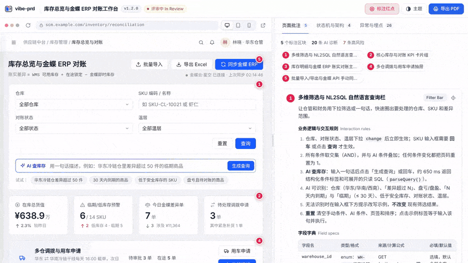
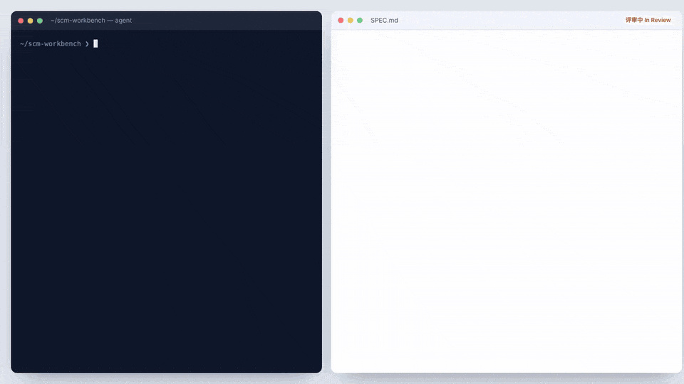

<div align="center">

# vibe-prd · 左图右注

**Write the contract before the code. Get the docs back from the code.**

One agent skill with two engines. `spec` turns a one-line idea into a `SPEC.md` contract before any code exists.
`prd` turns an HTML or React prototype you already have into a clickable, single-file **left-UI / right-annotation** PRD.

[](LICENSE)
[](#30-second-quick-start)
[](#30-second-quick-start)
[](#30-second-quick-start)
[](#30-second-quick-start)
[](https://gugusiyuan49.github.io/vibe-prd/examples/b2b-inventory-workbench/)

English · [简体中文](README_zh.md)

</div>

Vibe coding gets you a working page in 10 minutes. Then you spend two hours in a fix-one-break-two loop, and when your team lead asks for the spec, there isn't one.

**vibe-prd fixes both ends.** Before you build, it makes your agent write the state machine, the edge cases and the API contract. After you build, it reads the page back and hands you a PRD your PM, QA and backend can click through.



**[Open the live demo](https://gugusiyuan49.github.io/vibe-prd/examples/b2b-inventory-workbench/)**: a vibe-coded B2B inventory and Kingdee ERP reconciliation workbench, reverse-engineered into a PRD. Hover the red badges.



## How it works

```text
                ┌─────────────────────────── vibe-prd ───────────────────────────┐
                │                                                                │
  one-line ────▶│  spec · FORWARD                                                │──▶ SPEC.md
  idea          │  roles → state machine → 5-category edge cases → schema & API  │    contract first,
                │  → 5-step checklist.  No business code until you say "go".     │    code second
                │                                                                │
                ├────────────────────────────────────────────────────────────────┤
                │                                                                │
  prototype ───▶│  prd · REVERSE                                                 │──▶ PRD_Viewer.html
  .html / .tsx  │  scan DOM → number regions → extract rules, fields, formulas   │    live UI on the left,
                │  → find the missing guardrails → Mermaid → one HTML file       │    annotations on the right
                │                                                                │
                └────────────────────────────────────────────────────────────────┘
```

## 30-second quick start

```bash
npx skills add gugusiyuan49/vibe-prd
```

That installs one skill folder (`SKILL.md` and two templates) into Claude Code, Cursor, Codex, Windsurf and the other agents that read [Agent Skills](https://agentskills.io). Then:

| Agent | Plan a feature → `SPEC.md` | Document a page → `PRD_Viewer.html` |
| --- | --- | --- |
| Claude Code, Cursor | `/vibe-prd spec "Build an ERP inventory reconciliation dashboard"` | `/vibe-prd prd ./prototype.html` |
| Codex | `$vibe-prd spec "Build an ERP inventory reconciliation dashboard"` | `$vibe-prd prd ./prototype.html` |
| Windsurf | `@vibe-prd spec "Build an ERP inventory reconciliation dashboard"` | `@vibe-prd prd ./prototype.html` |
| Any agent | "Spec this before coding: an ERP reconciliation dashboard" | "Write a 左图右注 PRD for ./prototype.html" |

No `npx`? Copy `skills/vibe-prd/` into `~/.claude/skills/` (or `~/.cursor/skills/`, `~/.codex/skills/`, `~/.codeium/windsurf/skills/`).

## What you get

### `spec` → `SPEC.md`

Five modules, always in this order ([full example](examples/b2b-inventory-workbench/SPEC.md)):

1. **Overview and roles**: goal, success metric, non-goals, and a role × capability matrix (✅ / ⛔ / 🔶 needs approval).
2. **Core state machine**: a Mermaid `stateDiagram-v2` with every cancel, timeout and rollback path, plus a transition table.
3. **5-category edge-case matrix**: empty state, boundary values, network and timeouts, concurrency, permissions. At least two cases each, with the UI copy and the backend fallback.
4. **Data schema and API contract**: SQL DDL, TypeScript types, endpoints with idempotency and permissions, error codes.
5. **Atomic checklist**: at most five steps, each with an acceptance check you can run.

The agent writes no business code until you reply `go`, then builds one step at a time.

### `prd` → `PRD_Viewer.html`

One HTML file. No build step, no server, no framework.

- **Left:** your real prototype, still clickable. A numbered red badge sits on each business region. Switch between desktop, tablet (768 px) and mobile (375 px).
- **Right, three tabs:** UI annotations (interaction rules, field dictionary, formulas, AI guardrail warnings), State and architecture (Mermaid state, flow and ER diagrams), Edge cases and tracking events.
- **Two-way sync:** hover a badge and its card scrolls into view and glows blue. Hover a card and the prototype scrolls to that region, outlines it in red and flashes the badge.
- **Built for review:** drag to resize, hide the badges, light or dark theme, and export to PDF (A4 landscape, every annotation expanded).
- **Works anywhere:** double-click to open. Offline, diagrams fall back to their Mermaid source. On a phone, you switch between the prototype and the PRD.

The guardrail warnings are the part reviewers remember. From the demo:

> **High** · `settle()` overwrites the Kingdee book quantity with no confirmation, no reason code and no approval threshold. One misclick changes the books.
> **Fix:** confirm the quantity and amount, require a reason code, route amounts over ¥5,000 to a manager, and write back through an adjustment document.

## Why vibe-prd?

| | Raw vibe coding | With vibe-prd |
| --- | --- | --- |
| Starting point | "build me a dashboard" and the code starts | `spec`: a contract you can review in two minutes |
| States | implied, scattered across click handlers | one state machine, every exit path named |
| Edge cases | found by your users | 5 categories, written down before the code |
| Data and API | whatever the first prompt produced | DDL, types, idempotency keys, error codes |
| "Done" means | it looks fine | five acceptance checks you can run |
| Handover | "read the code" | one HTML file: click the UI, read the rules |
| Hidden gaps | invisible until production | guardrail warnings that name the function |

## The demo

[`examples/b2b-inventory-workbench`](examples/b2b-inventory-workbench) holds all three stages of one feature:

| File | What it is |
| --- | --- |
| [`raw-prototype.html`](examples/b2b-inventory-workbench/raw-prototype.html) | The page as vibe coding left it: filters with natural-language search, KPI cards, a reconciliation table, a transfer drawer, ERP sync. It works, and it skips a few guardrails on purpose. |
| [`SPEC.md`](examples/b2b-inventory-workbench/SPEC.md) | Forward mode: the contract you would have written first. |
| [`index.html`](examples/b2b-inventory-workbench/index.html) | Reverse mode: the prototype on the left, a full PRD on the right. |

Run it locally by double-clicking `index.html`, or:

```bash
git clone https://github.com/gugusiyuan49/vibe-prd.git
open vibe-prd/examples/b2b-inventory-workbench/index.html     # Windows: start, Linux: xdg-open
```

## Repository layout

```text
vibe-prd/
├── skills/vibe-prd/
│   ├── SKILL.md                    # the skill: routing, both modes, data contract, Mermaid rules
│   └── templates/
│       ├── spec-template.md        # skeleton for SPEC.md
│       └── left-right-prd.html     # the single-file 左图右注 viewer
├── examples/b2b-inventory-workbench/
│   ├── raw-prototype.html
│   ├── SPEC.md
│   └── index.html
└── assets/                         # README GIFs
```

## FAQ

**Does my code leave my machine?** No. The skill runs inside your agent, and the viewer is a local file. The only network request is the Mermaid script (jsDelivr, then unpkg, then npmmirror).

**Can it document React or Vue?** Yes. The agent captures the rendered DOM if the app is running, or ports the component to static HTML with the same class names (SKILL.md, step B1).

**Which language does it write in?** Yours. Chinese in, Chinese out. Code identifiers stay in English.

**How do I fix a wrong annotation?** Edit the `window.VIBE_PRD` object at the bottom of the generated HTML and reload. Badge numbers that don't match an annotation are flagged in the toolbar and in the console.

## Star history

If vibe-prd saved you one bug loop, a ⭐ helps the next person find it.

[](https://star-history.com/#gugusiyuan49/vibe-prd&Date)

## License

[MIT](LICENSE)
