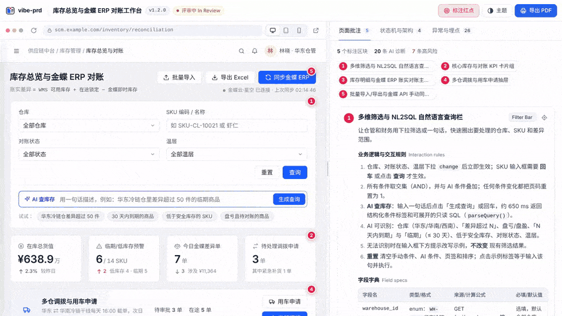
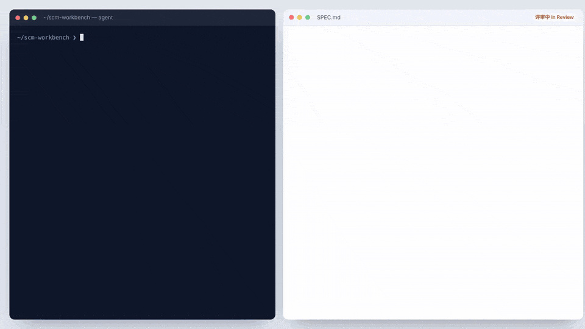

<div align="center">

# vibe-prd · 左图右注.skill

**正向防屎山，逆向补文档。**

一个 Agent Skill，两台引擎：`spec` 在写代码之前，把一句话需求变成带状态机和异常矩阵的 `SPEC.md`；
`prd` 把你已经写好的 HTML / React 原型，一键逆向成大厂标准的「左图右注」交互式 PRD，单个 HTML 文件，双击就能打开。

[](LICENSE)
[](#30-秒上手)
[](#30-秒上手)
[](#30-秒上手)
[](#30-秒上手)
[](https://gugusiyuan49.github.io/vibe-prd/examples/b2b-inventory-workbench/)

[English](README.md) · 简体中文

</div>

Vibe Coding 10 分钟写出页面，接下来 2 小时陷在「改一个 Bug 冒出两个」的死循环里；组长一句「需求文档发我看看」，你什么也拿不出来。

**vibe-prd 两头都管。** 写之前，逼 Agent 先把状态机、异常边界和接口契约写清楚；写完之后，把页面读回来，生成一份产品、测试、后端都能直接点着看的 PRD。



**[👉 打开在线 Demo](https://gugusiyuan49.github.io/vibe-prd/examples/b2b-inventory-workbench/)**：一个用 Vibe Coding 写出来的「B2B 库存总览与金蝶 ERP 对账工作台」，被逆向成完整 PRD。鼠标放到红点上试试。



## 双引擎工作流

```text
                ┌─────────────────────────── vibe-prd ───────────────────────────┐
                │                                                                │
  one-line ────▶│  spec · FORWARD                                                │──▶ SPEC.md
  idea          │  roles → state machine → 5-category edge cases → schema & API  │    先定契约
                │  → 5-step checklist.  No business code until you say "go".     │    再写代码
                │                                                                │
                ├────────────────────────────────────────────────────────────────┤
                │                                                                │
  prototype ───▶│  prd · REVERSE                                                 │──▶ PRD_Viewer.html
  .html / .tsx  │  scan DOM → number regions → extract rules, fields, formulas   │    左图：可交互原型
                │  → find the missing guardrails → Mermaid → one HTML file       │    右注：结构化批注
                │                                                                │
                └────────────────────────────────────────────────────────────────┘
```

## 30 秒上手

```bash
npx skills add gugusiyuan49/vibe-prd
```

一条命令装好（一个 `SKILL.md` 加两个模板），Claude Code、Cursor、Codex、Windsurf 以及所有支持 [Agent Skills](https://agentskills.io) 的 Agent 都能用。然后：

| Agent | 正向：规划新功能 → `SPEC.md` | 逆向：给现有页面补文档 → `PRD_Viewer.html` |
| --- | --- | --- |
| Claude Code、Cursor | `/vibe-prd spec "做一个 ERP 库存对账看板"` | `/vibe-prd prd ./prototype.html` |
| Codex | `$vibe-prd spec "做一个 ERP 库存对账看板"` | `$vibe-prd prd ./prototype.html` |
| Windsurf | `@vibe-prd spec "做一个 ERP 库存对账看板"` | `@vibe-prd prd ./prototype.html` |
| 任意 Agent | 「先别写代码，帮我写 SPEC：做一个 ERP 库存对账看板」 | 「给 ./prototype.html 补一份左图右注 PRD」 |

不想用 `npx`？把 `skills/vibe-prd/` 整个文件夹复制到 `~/.claude/skills/`（或 `~/.cursor/skills/`、`~/.codex/skills/`、`~/.codeium/windsurf/skills/`）即可。

## 你会得到什么

### `spec` → `SPEC.md`（正向契约）

固定五个模块，顺序不变（[完整示例](examples/b2b-inventory-workbench/SPEC.md)）：

1. **业务目标与角色权限矩阵**：目标、可量化的成功指标、不做什么，以及「角色 × 能力」矩阵（✅ 允许 / ⛔ 禁止 / 🔶 需审批）。
2. **核心状态机**：Mermaid `stateDiagram-v2`，正常路径之外，取消、超时、回滚一条不落，附流转规则表。
3. **五维异常与边界矩阵**：空数据与冷启动、边界与溢出、弱网与超时、并发冲突、权限与登录态，每类至少 2 条，写清前端文案和后端兜底。
4. **数据模型与接口契约**：SQL DDL、TypeScript 类型、带幂等与权限说明的接口表、错误码。
5. **原子化开发清单**：最多 5 步，每一步都带可执行的验收条件。

你回复 `go` 之前，Agent 不写任何业务代码；之后一步一步来，做完一步验收一步。

### `prd` → `PRD_Viewer.html`（逆向左图右注）

一个 HTML 文件。不用构建、不用服务器、不依赖框架。

- **左图**：你的真实原型，照样能点、能输入。每个业务区块右上角挂一个带呼吸动效的红色编号；可切换桌面、平板 768、手机 375 三种尺寸。
- **右注，三个 Tab**：页面批注（交互规则、字段字典、计算公式、AI 诊断补充建议）、状态机与架构（Mermaid 状态图、流程图、ER 图）、异常与埋点。
- **左右双向联动**：悬停左边的红点，右边对应卡片平滑滚动并亮起蓝色光晕；悬停右边的卡片，左边原型自动滚到那个区块，红色虚线框加编号闪烁。
- **为评审而生**：拖拽调整左右宽度、一键隐藏红点、浅色/深色主题、导出 PDF（A4 横版，所有批注自动展开）。
- **哪里都能打开**：双击即开；断网时图表自动降级显示 Mermaid 源码；手机上在「原型 / PRD」之间切换。

评审会上最有用的是「AI 诊断补充建议」，它会指出原型里漏掉的边界，并写明是哪个函数。Demo 里的一条：

> **高** · `settle()` 直接把金蝶账面覆盖成 WMS 数量：没有二次确认、没有原因码、没有金额审批阈值，误点即改账且无法撤销。
> **建议：** 弹窗确认差异量与金额并必填原因码；差异金额 > ¥5,000 走主管审批；通过「调整单」回写金蝶，而不是直接改数。

## 为什么用 vibe-prd？

| | 直接 Vibe Coding | 用 vibe-prd |
| --- | --- | --- |
| 起点 | 「帮我做个看板」，直接开写 | `spec`：两分钟能评审完的契约 |
| 状态 | 散落在各个点击事件里 | 一张状态机，每条出口都有名字 |
| 异常与边界 | 等用户替你发现 | 五大类，写代码之前就列好 |
| 数据与接口 | 第一版提示词生成什么就是什么 | DDL、类型、幂等键、错误码 |
| 「做完了」 | 看起来没问题 | 五条能跑的验收条件 |
| 交接 | 「自己看代码吧」 | 一个 HTML：点原型、看规则 |
| 隐藏的坑 | 上线才暴露 | AI 诊断直接点名到函数 |

## 在线 Demo

[`examples/b2b-inventory-workbench`](examples/b2b-inventory-workbench) 是同一个功能的三个阶段：

| 文件 | 内容 |
| --- | --- |
| [`raw-prototype.html`](examples/b2b-inventory-workbench/raw-prototype.html) | Vibe Coding 写出来的原始页面：多维筛选 + AI 自然语言查库存、KPI 卡片、账实对账表格、调拨用车抽屉、金蝶同步。能用，但故意漏了几处兜底。 |
| [`SPEC.md`](examples/b2b-inventory-workbench/SPEC.md) | 正向模式：本该在写代码之前就定下的契约。 |
| [`index.html`](examples/b2b-inventory-workbench/index.html) | 逆向模式：左边原型，右边完整 PRD。 |

本地体验：直接双击 `index.html`，或者：

```bash
git clone https://github.com/gugusiyuan49/vibe-prd.git
open vibe-prd/examples/b2b-inventory-workbench/index.html     # Windows 用 start，Linux 用 xdg-open
```

## 目录结构

```text
vibe-prd/
├── skills/vibe-prd/
│   ├── SKILL.md                    # 技能本体：模式路由、正逆双模式、数据契约、Mermaid 规范
│   └── templates/
│       ├── spec-template.md        # SPEC.md 骨架
│       └── left-right-prd.html     # 单文件「左图右注」外壳
├── examples/b2b-inventory-workbench/
│   ├── raw-prototype.html
│   ├── SPEC.md
│   └── index.html
└── assets/                         # README 里的 GIF
```

## 常见问题

**代码会上传到哪里吗？** 不会。技能在你自己的 Agent 里运行，生成的是本地文件。唯一的网络请求是加载 Mermaid（依次尝试 jsDelivr、unpkg、npmmirror，国内会优先走 npmmirror）。

**能逆向 React / Vue 组件吗？** 能。应用在跑的话，Agent 直接抓渲染后的 DOM；没在跑，就按相同的类名把组件转成静态 HTML（见 SKILL.md 第 B1 步）。

**输出什么语言？** 跟你走：中文提问就写中文，代码标识符保持英文。

**批注写错了怎么改？** 打开生成的 HTML，改底部的 `window.VIBE_PRD` 数据对象，刷新即可。编号对不上的地方会在工具栏和控制台里提示。

## Star 趋势

如果 vibe-prd 帮你少掉进一次改 Bug 死循环，点个 ⭐ 收藏一下，防止走丢，也让更多人看到。

[](https://star-history.com/#gugusiyuan49/vibe-prd&Date)

## License

[MIT](LICENSE)
