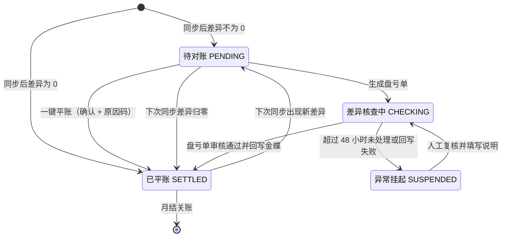
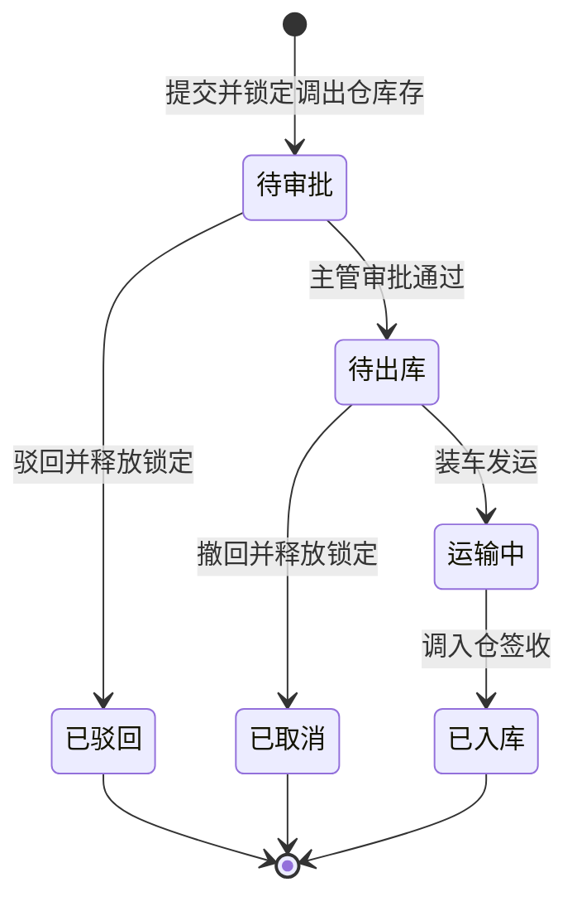
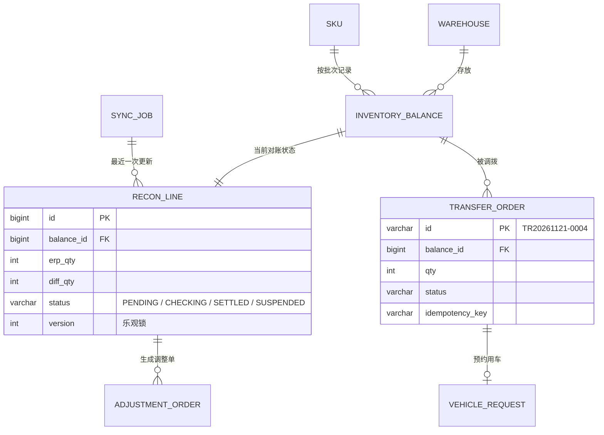

# SPEC · 库存总览与金蝶 ERP 对账工作台

| 版本 Version | 状态 Status | 生成方式 Generated by | 日期 Date |
| --- | --- | --- | --- |
| v1.0 | 评审中 In Review | `/vibe-prd spec` | 2026-11-21 |

> **一句话需求 One-line request:** 「做一个 B 端库存总览和金蝶 ERP 对账工作台：能按仓库和 SKU 筛选，看 WMS 跟金蝶的账实差异，一键平账或生成盘亏单，还能发起多仓调拨和用车申请，最好支持一句话查库存。」

这是 vibe-prd 正向模式的示例输出：写代码之前先把契约定下来。同一页面做出原型后的逆向 PRD 见 [index.html](index.html)（左图右注）。

## 0. 假设与待确认 · Assumptions & open questions

| # | 假设 Assumption | 如果不成立 Impact if wrong |
| --- | --- | --- |
| A1 | ERP 为金蝶云·星空（公有云），通过 WebAPI `ExecuteBillQuery` 读取即时库存表单 `STK_Inventory`；WMS 为自研系统，数据库是 PostgreSQL | 若是本地部署的金蝶 K/3 WISE，同步方式改为中间库或数据库视图，第 4.5 节重写 |
| A2 | 3 个仓库，约 5 万个「仓库 × SKU × 批次」组合；单次全量同步 ≤ 5 万行 | 超过 20 万行需改为分仓分批 + 增量同步 |
| A3 | 对账口径：差异量 = WMS 可用 + 在途锁定 − 金蝶即时库存，均为基本单位 | 若金蝶侧已包含调拨在途，需要剔除，否则重复计算 |
| A4 | 同步频率：每 30 分钟增量、每天 02:00 全量，另可手动触发 | 频率越高，越容易触达金蝶 API 调用配额 |
| A5 | NL2SQL 使用公司已采购的大模型 API，只生成只读查询 | 不允许调用外部模型时，降级为规则解析（原型现状） |

**待确认 Open questions**

1. 平账要不要在金蝶侧生成「盘盈单 / 盘亏单」或「其他出入库单」回写？还是只调整 WMS？（影响 `adjustment_order` 与回写接口）
2. 差异金额审批阈值 ¥5,000 是否合适？由仓储主管还是财务经理审批？
3. 冷链调拨是否必须由自有车队承运？（影响 `vehicle_request` 是否对接 TMS）

## 1. 业务目标与角色权限 · Product overview & user roles

### 1.1 目标与成功指标 · Goal & success metrics

- **业务目标 Goal:** 把财务每天在 Excel 里人工比对 WMS 与金蝶的工作，变成系统自动比对、当场处理，差异当天闭环。
- **成功指标 Success metric:** 账实一致率（无差异行 ÷ 总行数）≥ 99.5%；差异从发现到处理完成的中位时长 ≤ 24 小时；月结前人工对账工时下降 70%。
- **不做什么 Non-goals:** 不生成金蝶财务凭证（由财务模块负责）；不做库位级对账；不做采购、销售单据的对账。

### 1.2 核心场景 · Key scenarios

| 场景 Scenario | 角色 Role | 触发 Trigger | 期望结果 Expected outcome |
| --- | --- | --- | --- |
| 每日例行对账 | 财务对账专员 | 早上 9:00 打开工作台 | 看到当日差异单，逐行平账或生成盘亏单 |
| 临期与缺货处理 | 供应链主管 | 「临期/低库存预警」数字上升 | 发起跨仓调拨并预约冷藏车 |
| 月结前核查 | 财务经理 | 月结前 3 天 | 差异全部平账，或挂起并写明原因 |
| 临时查询 | 任一角色 | 想看「华东冷链仓差异超过 50 件的临期商品」 | 一句话查询，得到结果和只读 SQL |

### 1.3 角色权限矩阵 · Role × capability matrix

| 能力 Capability | 仓库管理员 | 财务对账专员 | 供应链主管 | 调度员 | 审计 |
| --- | :---: | :---: | :---: | :---: | :---: |
| 查看库存与差异 | ✅ 仅本仓 | ✅ | ✅ | ✅ | ✅ |
| AI 查库存 | ✅ 仅本仓 | ✅ | ✅ | ⛔ | ✅ |
| 手动同步金蝶 | ✅ 仅本仓 | ✅ | ✅ | ⛔ | ⛔ |
| 一键平账（差异金额 ≤ ¥5,000） | ⛔ | ✅ | ✅ | ⛔ | ⛔ |
| 一键平账（差异金额 > ¥5,000） | ⛔ | 🔶 | ✅ | ⛔ | ⛔ |
| 生成盘亏单 | ✅ | ✅ | ✅ | ⛔ | ⛔ |
| 审核盘亏单 | ⛔ | ✅ | ✅ | ⛔ | ⛔ |
| 发起调拨 | ✅ 仅本仓调出 | ⛔ | ✅ | ⛔ | ⛔ |
| 审批调拨 | ⛔ | ⛔ | ✅ | ⛔ | ⛔ |
| 用车派单 | ⛔ | ⛔ | ✅ | ✅ | ⛔ |
| 导入 / 导出 | ✅ 仅本仓 | ✅ | ✅ | ⛔ | 仅导出 |

图例 Legend: ✅ 允许 allowed, ⛔ 禁止 denied, 🔶 需审批 needs approval

## 2. 核心状态机 · Core state machine

### 2.1 对账行 RECON_LINE 生命周期 · Lifecycle

每个「仓库 × SKU × 批次」只有一条当前对账行，每次同步更新它（历史写入 `recon_line_history`）。



### 2.2 流转规则 · Transition table

| From | To | 触发 Trigger | 守卫条件 Guard | 副作用 Side effects |
| --- | --- | --- | --- | --- |
| [*] | PENDING | 同步任务比对完成 | `diff_qty ≠ 0` | 计入当日差异单 `new_diff` |
| [*] | SETTLED | 同步任务比对完成 | `diff_qty = 0` | 计入 `auto_settled` |
| PENDING | SETTLED | 一键平账 | 有 `recon:settle` 权限；金额 ≤ 阈值或已审批；`version` 一致 | 生成调整单 `adjustment_order(type=SETTLE)` 并回写金蝶；记录操作日志 |
| PENDING | CHECKING | 生成盘亏单 | `diff_qty < 0`；该行没有未完结的调整单 | 生成 `adjustment_order(type=LOSS, status=PENDING_AUDIT)` |
| CHECKING | SETTLED | 盘亏单审核通过 | 金蝶回写成功 | 写入 `settled_by`、`settled_at` |
| CHECKING | SUSPENDED | 定时任务巡检 | 超过 48 小时未处理，或回写失败 3 次 | 通知供应链主管 |
| SUSPENDED | CHECKING | 人工复核 | 必填复核说明 | 记录复核人 |
| SETTLED | PENDING | 同步任务比对完成 | 出现新的 `diff_qty ≠ 0` | `version + 1`，重新计入差异单 |
| SETTLED | [*] | 月结关账 | 会计期间已关闭 | 行变为只读 |

### 2.3 调拨单 TRANSFER_ORDER 生命周期 · Lifecycle



提交即锁定：调出仓 `wms_available − qty`、`in_transit_locked + qty`，账实差异不变；驳回或撤回时反向释放。

## 3. 五维异常与边界条件 · 5-category edge-case matrix

| 场景分类 | 触发条件 | 前端 UI/文案表现 | 后端/数据兜底策略 |
| --- | --- | --- | --- |
| 空数据与冷启动 Empty / zero state | 新仓库刚接入，金蝶从未同步 | 表格空状态「还没有对账数据」+ 主按钮「立即同步金蝶」；KPI 显示「—」 | 返回 `items: []`、`lastSyncAt: null`，前端据此区分「未同步」和「无差异」 |
| 空数据与冷启动 Empty / zero state | 筛选与 AI 条件的交集为空 | 「没有符合条件的商品」，列出生效条件，提供「清除 AI 条件」「重置筛选」 | 返回 `total = 0`，HTTP 200 |
| 空数据与冷启动 Empty / zero state | 「有差异」页签为 0 | 绿色空状态「今日账实一致」+ 上次同步时间 | 正常返回，不触发告警 |
| 边界与溢出 Boundary / overflow | 差异 ≥ 1,000 件或差异金额 ≥ ¥5,000 | 差异加粗并显示「大额」标签；「一键平账」变为「提交审批」 | 服务端按金额阈值强制审批，前端隐藏按钮不等于授权 |
| 边界与溢出 Boundary / overflow | 调拨数量为 0、负数、小数、超过可用量或大于 99,999 | 字段下方即时报错 | DB `CHECK (qty > 0 AND qty <= 99999)` + 服务端二次校验，返回 42201 |
| 边界与溢出 Boundary / overflow | AI 查询超过 200 字，或包含 DROP / UPDATE 等关键字 | 输入框显示字数并截断；提示「只支持查询类问题」 | SQL AST 白名单：仅 SELECT、仅 `v_inventory_recon`、强制 `LIMIT 200` |
| 网络与接口 Network / API | 金蝶 WebAPI 超过 30 s 或返回错误 | 状态行变红「同步失败：金蝶接口超时」并提供「重试」 | 指数退避重试 3 次；仍失败时 `sync_job.status = FAILED` 并告警 |
| 网络与接口 Network / API | 列表首屏加载超过 300 ms | KPI 与表格显示骨架屏，不闪现「暂无数据」 | 列表接口 P95 < 500 ms，超时降级读缓存视图 |
| 网络与接口 Network / API | 网络抖动导致平账、调拨请求重复 | 按钮进入加载态并禁用 | `Idempotency-Key` 24 小时去重，重复请求返回第一次的结果 |
| 并发与状态冲突 Concurrency | 两名财务同时平账同一行 | 后提交的人看到「该行已被王敏于 10:21 平账，已为你刷新」 | `recon_line.version` 乐观锁，冲突返回 40901 |
| 并发与状态冲突 Concurrency | 同步进行中有人对旧数据平账 | 同步期间操作按钮置灰，提示「正在同步金蝶，稍后再试」 | 运行中任务唯一索引 `uq_sync_running`；写操作返回 42301 |
| 并发与状态冲突 Concurrency | 提交调拨时可用库存已被其他单据锁定 | 数量字段报错「可用库存已变为 320 件」并刷新可用量 | 事务内 `SELECT … FOR UPDATE` 复核，不足返回 40902 |
| 权限与登录态 Permission / auth | 只能看本仓的仓管员访问其他仓库 | 下拉只列出有权限的仓；手改 URL 显示 403 页面 | 所有查询统一注入 `warehouse_id IN (:scope)`，NL2SQL 结果同样过滤 |
| 权限与登录态 Permission / auth | 没有 `recon:settle` 权限的角色 | 不显示「一键平账」，保留「生成盘亏单」 | 接口校验权限，越权返回 40301 |
| 权限与登录态 Permission / auth | 登录态失效时提交调拨 | 弹出重新登录，表单内容保留，登录后自动重新提交 | 401 后用 refresh token 续期；草稿暂存 sessionStorage |

## 4. 数据模型与接口契约 · Data schema & API contract

### 4.1 ER 概览 · ER overview



### 4.2 SQL DDL（PostgreSQL 15）

```sql
CREATE TYPE recon_status    AS ENUM ('PENDING', 'CHECKING', 'SETTLED', 'SUSPENDED');
CREATE TYPE transfer_status AS ENUM ('PENDING_APPROVAL', 'REJECTED', 'TO_SHIP', 'IN_TRANSIT', 'RECEIVED', 'CANCELLED');

CREATE TABLE warehouse (
  id          VARCHAR(16) PRIMARY KEY,               -- WH-SH01
  name        VARCHAR(64) NOT NULL,                  -- 华东冷链仓
  erp_stock_no VARCHAR(32) NOT NULL UNIQUE           -- 金蝶仓库编码
);

CREATE TABLE sku (
  sku_code         VARCHAR(32) PRIMARY KEY,          -- SKU-CL-10021
  name             VARCHAR(128) NOT NULL,
  spec             VARCHAR(64),
  temp_zone        VARCHAR(8) NOT NULL CHECK (temp_zone IN ('冷冻', '冷藏', '常温')),
  unit_cost        NUMERIC(12, 2) NOT NULL CHECK (unit_cost >= 0),   -- 加权平均成本，元
  safety_stock     INT NOT NULL DEFAULT 0 CHECK (safety_stock >= 0),
  erp_material_no  VARCHAR(32) NOT NULL UNIQUE      -- 金蝶物料编码
);

CREATE TABLE inventory_balance (
  id                 BIGSERIAL PRIMARY KEY,
  warehouse_id       VARCHAR(16) NOT NULL REFERENCES warehouse (id),
  sku_code           VARCHAR(32) NOT NULL REFERENCES sku (sku_code),
  batch_no           VARCHAR(32) NOT NULL,
  expiry_date        DATE,
  wms_available      INT NOT NULL CHECK (wms_available >= 0),
  in_transit_locked  INT NOT NULL DEFAULT 0 CHECK (in_transit_locked >= 0),
  version            INT NOT NULL DEFAULT 0,
  updated_at         TIMESTAMPTZ NOT NULL DEFAULT now(),
  UNIQUE (warehouse_id, sku_code, batch_no)
);

CREATE TABLE sync_job (
  id               BIGSERIAL PRIMARY KEY,
  warehouse_id     VARCHAR(16) REFERENCES warehouse (id),   -- NULL 表示全部仓库
  trigger_type     VARCHAR(8) NOT NULL CHECK (trigger_type IN ('MANUAL', 'CRON')),
  status           VARCHAR(8) NOT NULL DEFAULT 'RUNNING' CHECK (status IN ('RUNNING', 'SUCCESS', 'FAILED')),
  idempotency_key  UUID UNIQUE,
  pulled           INT,
  auto_settled     INT,
  new_diff         INT,
  error_message    TEXT,
  started_by       BIGINT,
  started_at       TIMESTAMPTZ NOT NULL DEFAULT now(),
  finished_at      TIMESTAMPTZ
);
-- 同一范围同一时刻只允许一个运行中的同步任务
CREATE UNIQUE INDEX uq_sync_running ON sync_job (COALESCE(warehouse_id, '*')) WHERE status = 'RUNNING';

CREATE TABLE recon_line (
  id           BIGSERIAL PRIMARY KEY,
  balance_id   BIGINT NOT NULL UNIQUE REFERENCES inventory_balance (id),
  sync_job_id  BIGINT NOT NULL REFERENCES sync_job (id),
  erp_qty      INT NOT NULL,
  diff_qty     INT NOT NULL,                  -- wms_available + in_transit_locked - erp_qty，同步时快照
  diff_amount  NUMERIC(14, 2) NOT NULL,       -- |diff_qty| × unit_cost
  status       recon_status NOT NULL DEFAULT 'PENDING',
  version      INT NOT NULL DEFAULT 0,        -- 乐观锁
  settled_by   BIGINT,
  settled_at   TIMESTAMPTZ,
  updated_at   TIMESTAMPTZ NOT NULL DEFAULT now()
);
CREATE INDEX idx_recon_open ON recon_line (status) WHERE status <> 'SETTLED';

CREATE TABLE adjustment_order (
  id             VARCHAR(20) PRIMARY KEY,     -- PK20261121-007
  recon_line_id  BIGINT NOT NULL REFERENCES recon_line (id),
  type           VARCHAR(8) NOT NULL CHECK (type IN ('SETTLE', 'LOSS', 'GAIN')),
  qty            INT NOT NULL,
  amount         NUMERIC(14, 2) NOT NULL,
  reason_code    VARCHAR(16) NOT NULL CHECK (reason_code IN ('COUNT_ERROR', 'MIX_UP', 'MISSED_DOC', 'DAMAGE')),
  status         VARCHAR(16) NOT NULL DEFAULT 'PENDING_AUDIT' CHECK (status IN ('PENDING_AUDIT', 'APPROVED', 'REJECTED', 'WRITTEN_BACK')),
  erp_bill_no    VARCHAR(32),                 -- 回写金蝶后的单据编号
  created_by     BIGINT NOT NULL,
  created_at     TIMESTAMPTZ NOT NULL DEFAULT now()
);
-- 同一对账行最多一张未完结的调整单（“生成盘亏单”天然幂等）
CREATE UNIQUE INDEX uq_adjustment_open ON adjustment_order (recon_line_id) WHERE status IN ('PENDING_AUDIT', 'APPROVED');

CREATE TABLE transfer_order (
  id                     VARCHAR(20) PRIMARY KEY,   -- TR20261121-0004
  transfer_type          VARCHAR(8) NOT NULL CHECK (transfer_type IN ('NORMAL', 'URGENT')),
  from_warehouse_id      VARCHAR(16) NOT NULL REFERENCES warehouse (id),
  to_warehouse_id        VARCHAR(16) NOT NULL REFERENCES warehouse (id),
  balance_id             BIGINT NOT NULL REFERENCES inventory_balance (id),
  qty                    INT NOT NULL CHECK (qty > 0 AND qty <= 99999),
  expected_arrival_date  DATE NOT NULL,
  status                 transfer_status NOT NULL DEFAULT 'PENDING_APPROVAL',
  remark                 VARCHAR(200),
  idempotency_key        UUID NOT NULL UNIQUE,
  version                INT NOT NULL DEFAULT 0,
  created_by             BIGINT NOT NULL,
  created_at             TIMESTAMPTZ NOT NULL DEFAULT now(),
  CHECK (from_warehouse_id <> to_warehouse_id)
);

CREATE TABLE vehicle_request (
  id            BIGSERIAL PRIMARY KEY,
  transfer_id   VARCHAR(20) NOT NULL UNIQUE REFERENCES transfer_order (id),
  vehicle_type  VARCHAR(16) NOT NULL CHECK (vehicle_type IN ('REEFER_4_2M', 'REEFER_7_6M', 'BOX_9_6M')),
  loading_time  TIME NOT NULL DEFAULT '16:00',
  status        VARCHAR(12) NOT NULL DEFAULT 'WAITING'
);

-- 页面与 NL2SQL 共用的只读视图（NL2SQL 只允许查询它）
CREATE VIEW v_inventory_recon AS
SELECT b.id AS balance_id, b.warehouse_id, b.sku_code, s.name AS sku_name, s.temp_zone, b.batch_no,
       (b.expiry_date - CURRENT_DATE) AS expiry_days,
       b.wms_available, b.in_transit_locked, r.erp_qty,
       b.wms_available + b.in_transit_locked - r.erp_qty AS diff_qty,
       s.safety_stock, s.unit_cost, r.status AS recon_status, r.version
FROM inventory_balance b
JOIN sku s        ON s.sku_code = b.sku_code
JOIN recon_line r ON r.balance_id = b.id;
```

### 4.3 TypeScript 类型 · Types

```ts
export type ReconStatus = 'PENDING' | 'CHECKING' | 'SETTLED' | 'SUSPENDED';
export type TempZone = '冷冻' | '冷藏' | '常温';
/** 0 正常 · 1 关注（≤ 安全库存 × 1.2）· 2 预警（≤ 安全库存）· 3 告警（≤ 安全库存 × 0.5 或缺货） */
export type WarnLevel = 0 | 1 | 2 | 3;

export interface ReconRow {
  reconLineId: number;
  balanceId: number;
  warehouseId: string;       // 'WH-SH01'
  skuCode: string;
  skuName: string;
  spec: string;
  tempZone: TempZone;
  batchNo: string;
  expiryDays: number;
  wmsAvailable: number;
  inTransitLocked: number;
  erpQty: number;
  diffQty: number;           // wmsAvailable + inTransitLocked - erpQty
  diffAmount: number;        // 元，2 位小数
  warnLevel: WarnLevel;
  status: ReconStatus;
  version: number;
}

export interface ReconQuery {
  warehouseId?: string;
  keyword?: string;          // ≤ 64 字符
  status?: ReconStatus;
  tempZone?: TempZone;
  tab?: 'all' | 'diff' | 'alert' | 'settled';
  sort?: 'diff_abs_desc' | 'diff_abs_asc';
  nlConditionId?: string;    // /api/nl2sql/parse 返回的条件 id，服务端复用已校验的条件
  page: number;              // 从 1 开始
  pageSize: 10 | 20 | 50;
}

export interface KpiSummary {
  stockValue: number;        // 元
  alertSkuCount: number;     // warnLevel >= 2 或 expiryDays <= 30
  skuTotal: number;
  diffBillCount: number;
  diffAmount: number;
  pendingTransferCount: number;
  deltaVsYesterday: Record<'stockValuePct' | 'alertSkuCount' | 'diffBillCount', number> | null;
  asOf: string;              // ISO 8601
}

export type ReasonCode = 'COUNT_ERROR' | 'MIX_UP' | 'MISSED_DOC' | 'DAMAGE';

export interface SettleRequest {
  version: number;
  reasonCode: ReasonCode;
  remark?: string;           // ≤ 200 字
}

export interface TransferRequest {
  transferType: 'NORMAL' | 'URGENT';
  fromWarehouseId: string;
  toWarehouseId: string;     // 必须不同于 fromWarehouseId
  balanceId: number;
  qty: number;               // 正整数，≤ 调出仓可用
  expectedArrivalDate: string;  // YYYY-MM-DD，≥ 明天（16:00 后提交为后天）
  vehicle?: {
    type: 'REEFER_4_2M' | 'REEFER_7_6M' | 'BOX_9_6M';   // 冷冻/冷藏 SKU 只能选 REEFER_*
    loadingTime: string;     // HH:mm，默认 16:00
  };
  remark?: string;           // ≤ 200 字
}

export interface SyncJob {
  id: number;
  status: 'RUNNING' | 'SUCCESS' | 'FAILED';
  pulled?: number;
  autoSettled?: number;
  newDiff?: number;
  errorMessage?: string;
  startedAt: string;
  finishedAt?: string;
}
```

### 4.4 接口契约 · Endpoints

| 方法 Method | 路径 Path | 用途 Purpose | 幂等 Idempotency | 权限 Permission |
| --- | --- | --- | --- | --- |
| GET | `/api/inventory/recon` | 分页查询对账行（`ReconQuery`） | 天然幂等 | `inventory:read`，行级仓库范围 |
| GET | `/api/inventory/kpis?warehouseId=` | KPI 汇总（`KpiSummary`） | 天然幂等 | `inventory:read` |
| POST | `/api/nl2sql/parse` | 一句话转条件 + 只读 SQL | 同一句话缓存 10 分钟 | `inventory:read` |
| POST | `/api/recon/lines/:id/settle` | 一键平账 | `version` + `Idempotency-Key` | `recon:settle` |
| POST | `/api/recon/settle-batch` | 批量平账（≤ 100 行） | 每行 `version` + `Idempotency-Key` | `recon:settle` |
| POST | `/api/recon/lines/:id/loss-orders` | 生成盘亏单 | 唯一索引 `uq_adjustment_open` | `recon:loss` |
| POST | `/api/transfers` | 发起调拨（可含用车） | `Idempotency-Key` 必填 | `transfer:create` |
| POST | `/api/erp/sync-jobs` | 手动触发金蝶同步 | 运行中任务唯一 + 60 秒冷却 | `erp:sync` |
| GET | `/api/erp/sync-jobs/:id` | 查询同步进度 | 天然幂等 | `erp:sync` |
| POST | `/api/exports` | 创建导出（> 5,000 行转异步任务） | `Idempotency-Key` | `inventory:export` |
| POST | `/api/imports` | 上传盘点表（≤ 10 MB / 1 万行） | 文件哈希去重 | `inventory:import` |

**示例 Example: 一键平账**

```http
POST /api/recon/lines/88231/settle
Idempotency-Key: 5b0e7c1a-3f2d-4c8e-9a51-2d7f0c6b9e14
Content-Type: application/json
```

```json
{
  "version": 3,
  "reasonCode": "COUNT_ERROR",
  "remark": "复盘确认少 12 袋，纸箱破损未登记"
}
```

成功 200：

```json
{
  "code": 0,
  "data": {
    "reconLineId": 88231,
    "status": "SETTLED",
    "version": 4,
    "adjustmentOrderId": "TZ20261121-031",
    "erpBillNo": "PK-000512"
  }
}
```

版本冲突 409：

```json
{
  "code": 40901,
  "message": "该行已被他人处理",
  "data": { "currentVersion": 4, "status": "SETTLED", "settledBy": "王敏", "settledAt": "2026-11-21T10:21:07+08:00" }
}
```

**示例 Example: 发起调拨并预约冷藏车**

```json
{
  "transferType": "URGENT",
  "fromWarehouseId": "WH-SH01",
  "toWarehouseId": "WH-GZ02",
  "balanceId": 10233,
  "qty": 500,
  "expectedArrivalDate": "2026-11-23",
  "vehicle": { "type": "REEFER_4_2M", "loadingTime": "16:00" },
  "remark": "门店双十二促销备货"
}
```

### 4.5 金蝶 WebAPI 字段映射 · Kingdee mapping

示例映射，字段名以金蝶开放平台的最新文档为准。

| 本系统字段 | 金蝶表单与字段 | 说明 |
| --- | --- | --- |
| `recon_line.erp_qty` | `STK_Inventory.FBaseQty` | 即时库存，基本单位数量 |
| `warehouse.erp_stock_no` | `STK_Inventory.FStockId.FNumber` | 仓库编码 |
| `sku.erp_material_no` | `STK_Inventory.FMaterialId.FNumber` | 物料编码 |
| `inventory_balance.batch_no` | `STK_Inventory.FLot.FNumber` | 批号 |

读取用 `ExecuteBillQuery`（`FormId = STK_Inventory`，每页 2,000 行分页拉取）。平账与盘亏的回写方式见待确认 Q1。

### 4.6 错误码 · Error codes

| code | HTTP | 含义 Meaning | 前端处理 Frontend handling |
| --- | --- | --- | --- |
| 40001 | 400 | 参数格式错误 | 字段级提示 |
| 40301 | 403 | 没有该仓库或该操作的权限 | 隐藏入口；直接访问显示 403 页 |
| 40901 | 409 | 版本冲突，该行已被他人处理 | 提示并刷新该行 |
| 40902 | 409 | 可用库存不足（已被其他单据锁定） | 展示最新可用量 |
| 42201 | 422 | 业务校验失败（调出仓 = 调入仓、数量越界、车型与温层不符） | 字段级错误 |
| 42301 | 423 | 仓库正在同步，暂不可写 | 操作按钮置灰并说明原因 |
| 42901 | 429 | 同步过于频繁（60 秒冷却） | 显示剩余秒数 |
| 50201 | 502 | 金蝶接口错误或超时 | 状态行变红 + 重试 |

## 5. 原子化开发与验收清单 · Atomic vibe-coding checklist

> 一次只做一步。做完跑验收，通过后再打勾。
> One step at a time. Run the acceptance check, then tick the box.

- [ ] **Step 1 · 数据层 Data layer:** 第 4.2 节的 DDL、视图，以及与原型一致的种子数据（3 个仓、14 个 SKU）。
  - 验收 Acceptance: `psql -f schema.sql && psql -f seed.sql` 无报错；`SELECT count(*) FROM v_inventory_recon WHERE diff_qty <> 0;` 返回 7。
- [ ] **Step 2 · 金蝶同步 ERP sync:** `POST /api/erp/sync-jobs`，含比对、运行中唯一、60 秒冷却和 3 次重试。
  - 验收 Acceptance: 用 mock 金蝶服务同步后生成 14 条对账行；60 秒内再次触发返回同一个 `job_id`；mock 返回 500 时重试 3 次后任务为 `FAILED`。
- [ ] **Step 3 · 查询、KPI 与 NL2SQL Read APIs:** `GET /api/inventory/recon`、`/kpis`，以及只读白名单的 `/api/nl2sql/parse`。
  - 验收 Acceptance: 「华东冷链仓差异超过 50 件」返回 1 行；「DROP TABLE sku」返回 42201；仓库管理员只能查到本仓数据。
- [ ] **Step 4 · 写操作 Write APIs:** 平账、盘亏单、调拨，全部带幂等键、乐观锁和金额审批阈值。
  - 验收 Acceptance: 同一个 `Idempotency-Key` 提交两次只生成一张调拨单；两个会话用同一 `version` 平账，第二个返回 40901；差异金额 > ¥5,000 的平账返回「需审批」。
- [ ] **Step 5 · 页面与异常态 UI & edge cases:** 按第 3 节实现空状态、骨架屏、错误态和权限态，接入附录埋点。
  - 验收 Acceptance: 断网、空数据、越权、版本冲突四种情况的界面与第 3 节一致；附录中的 11 个埋点在测试环境全部上报。

## 附录 · Appendix

### 埋点 · Tracking events

| event_name | 触发 Trigger | properties |
| --- | --- | --- |
| `inventory_filter_apply` | 下拉筛选变化或点击「查询」 | warehouse_id, recon_status, temp_zone, keyword_len, result_count |
| `nl2sql_query_submit` | 点击「生成查询」或回车 | query_len, parsed, cond_count, latency_ms |
| `nl2sql_sql_view` | 点击「查看 SQL」 | cond_count |
| `kpi_cards_view` | KPI 首次渲染 | warehouse_scope, alert_sku_count, diff_bill_count |
| `recon_settle_click` | 点击「一键平账」或「批量平账」 | sku_codes, diff_qty, diff_amount, is_batch |
| `recon_loss_order_create` | 点击「生成盘亏单」 | sku_code, diff_qty, order_id |
| `transfer_submit` | 调拨抽屉点击「提交申请」 | from_wh, to_wh, sku_code, qty, need_vehicle, vehicle_type, result |
| `transfer_validation_error` | 提交时校验失败 | fields, transfer_type |
| `erp_sync_click` | 点击「同步金蝶 ERP」 | since_last_sync_s, warehouse_scope |
| `erp_sync_result` | 同步任务结束 | status, pulled, auto_settled, new_diff, duration_ms |
| `recon_export` | 点击「导出 Excel」 | row_count, tab, filter_hash |

### 术语表 · Glossary

| 术语 Term | 定义 Definition |
| --- | --- |
| WMS 可用库存 | 在库 − 冻结 − 已分配，可以被调拨和出库使用的数量 |
| 在途锁定 | 已提交、尚未发运的调拨单和出库单占用的数量 |
| 金蝶即时库存 | 金蝶云·星空即时库存表单（`STK_Inventory`）中的数量 |
| 账实差异 | WMS 可用 + 在途锁定 − 金蝶即时库存；小于 0 为盘亏，大于 0 为盘盈 |
| 平账 | 以 WMS 实物为准，通过调整单让金蝶账面与实物一致 |
| 临期 | 剩余效期 ≤ 30 天；≤ 7 天为严重临期 |

---

> 下一步：回复 `go` 开始 Step 1，或告诉我要改哪里。
> Next: reply `go` to build Step 1, or tell me what to change.
