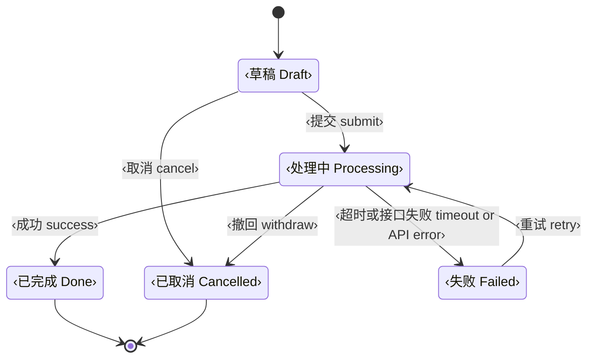
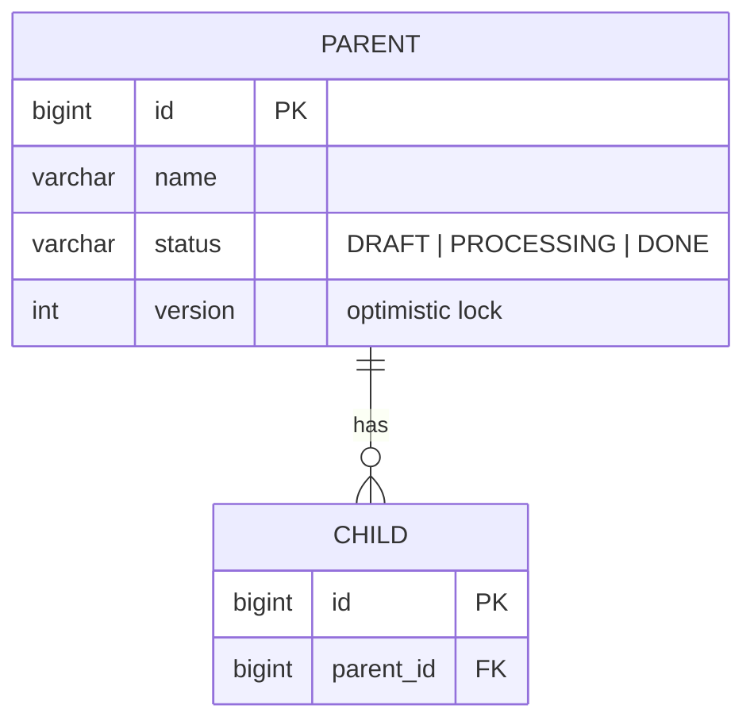

# SPEC · ‹功能名 Feature name›

<!--
vibe-prd fill-in rules (delete this comment block before saving):
- Replace every ‹…› placeholder. Keep modules 1–5, their numbering and their order.
- Write in the user's language; keep identifiers, Mermaid IDs and event names in ASCII.
- Delete rows you don't need, but never drop below 2 rows per edge-case category.
- No business code is written until the user approves this file.
-->

| 版本 Version | 状态 Status | 生成方式 Generated by | 日期 Date |
| --- | --- | --- | --- |
| v0.1 | 草稿 Draft | `/vibe-prd spec` | ‹YYYY-MM-DD› |

> **一句话需求 One-line request:** ‹用户的原话 the user's own words›

## 0. 假设与待确认 · Assumptions & open questions

| # | 假设 Assumption | 如果不成立 Impact if wrong |
| --- | --- | --- |
| A1 | ‹技术栈 / 部署方式 stack and hosting› | ‹影响哪一模块 what changes› |
| A2 | ‹数据规模 data volume› | ‹…› |
| A3 | ‹外部系统 external systems› | ‹…› |

**待确认 Open questions**

1. ‹只列会改变数据模型或权限的问题 only questions that would change the data model or permissions›

## 1. 业务目标与角色权限 · Product overview & user roles

### 1.1 目标与成功指标 · Goal & success metrics

- **业务目标 Goal:** ‹解决谁的什么问题 whose problem, solved how›
- **成功指标 Success metric:** ‹可量化 measurable, e.g. 账实一致率 ≥ 99.5%›
- **不做什么 Non-goals:** ‹明确排除的范围 what is out of scope›

### 1.2 核心场景 · Key scenarios

| 场景 Scenario | 角色 Role | 触发 Trigger | 期望结果 Expected outcome |
| --- | --- | --- | --- |
| ‹…› | ‹…› | ‹…› | ‹…› |

### 1.3 角色权限矩阵 · Role × capability matrix

| 能力 Capability | ‹角色 A› | ‹角色 B› | ‹角色 C› |
| --- | :---: | :---: | :---: |
| ‹查看 View› | ✅ | ✅ | ✅ |
| ‹创建 Create› | ✅ | ⛔ | ⛔ |
| ‹高风险操作 Risky action› | 🔶 | ⛔ | ✅ |

图例 Legend: ✅ 允许 allowed, ⛔ 禁止 denied, 🔶 需审批 needs approval

## 2. 核心状态机 · Core state machine

### 2.1 ‹实体 Entity› 生命周期 Lifecycle



### 2.2 流转规则 · Transition table

| From | To | 触发 Trigger | 守卫条件 Guard | 副作用 Side effects |
| --- | --- | --- | --- | --- |
| DRAFT | PROCESSING | ‹…› | ‹谁、什么条件下 who, under which condition› | ‹写日志、发通知 logs, notifications› |

## 3. 五维异常与边界条件 · 5-category edge-case matrix

| 场景分类 | 触发条件 | 前端 UI/文案表现 | 后端/数据兜底策略 |
| --- | --- | --- | --- |
| 空数据与冷启动 Empty / zero state | ‹首次使用，无数据› | ‹空状态插画 + 引导按钮文案› | ‹返回空数组 + total=0，不报错› |
| 空数据与冷启动 Empty / zero state | ‹筛选无结果› | ‹“没有符合条件的…” + 清空筛选› | ‹…› |
| 边界与溢出 Boundary / overflow | ‹超长文本 / 负数 / 极值› | ‹截断 + tooltip / 输入即时校验› | ‹DB 约束 + 服务端二次校验› |
| 边界与溢出 Boundary / overflow | ‹非法格式› | ‹…› | ‹…› |
| 网络与接口 Network / API | ‹慢响应 > 1 s› | ‹骨架屏 Skeleton› | ‹超时阈值、重试策略› |
| 网络与接口 Network / API | ‹重复提交 / 500› | ‹按钮 loading 且禁用 / 可重试提示› | ‹Idempotency-Key 去重› |
| 并发与状态冲突 Concurrency | ‹两人同时编辑同一条› | ‹“数据已被他人更新，请刷新”› | ‹version 乐观锁，返回 409› |
| 并发与状态冲突 Concurrency | ‹状态已过期› | ‹…› | ‹…› |
| 权限与登录态 Permission / auth | ‹越权访问› | ‹403 页面 / 按钮置灰并说明原因› | ‹服务端鉴权 + 行级数据范围› |
| 权限与登录态 Permission / auth | ‹登录态失效› | ‹保留表单草稿，跳转登录后回填› | ‹401 + refresh token› |

## 4. 数据模型与接口契约 · Data schema & API contract

### 4.1 ER 概览 · ER overview



### 4.2 SQL DDL

```sql
-- ‹表名 table›: ‹用途 purpose›
CREATE TABLE ‹table_name› (
  id          BIGSERIAL PRIMARY KEY,
  status      VARCHAR(20) NOT NULL DEFAULT 'DRAFT',
  version     INT NOT NULL DEFAULT 0,          -- 乐观锁 optimistic lock
  created_by  BIGINT NOT NULL,
  created_at  TIMESTAMPTZ NOT NULL DEFAULT now(),
  updated_at  TIMESTAMPTZ NOT NULL DEFAULT now()
);
```

### 4.3 TypeScript 类型 · Types

```ts
export type ‹Entity›Status = 'DRAFT' | 'PROCESSING' | 'DONE' | 'CANCELLED' | 'FAILED';

export interface ‹Entity› {
  id: string;
  status: ‹Entity›Status;
  version: number;
  updatedAt: string; // ISO 8601
}
```

### 4.4 接口契约 · Endpoints

| 方法 Method | 路径 Path | 用途 Purpose | 幂等 Idempotency | 权限 Permission |
| --- | --- | --- | --- | --- |
| GET | `/api/‹resources›` | ‹分页查询 paged list› | 天然幂等 natural | ‹角色 role› |
| POST | `/api/‹resources›` | ‹创建 create› | `Idempotency-Key` header | ‹…› |
| PATCH | `/api/‹resources›/:id` | ‹更新 update› | `version` 字段 | ‹…› |

**示例 Example: ‹主写接口 main write call›**

```http
POST /api/‹resources›
Idempotency-Key: 7f9c2ba4-...
Content-Type: application/json
```

```json
{
  "‹field›": "‹value›"
}
```

```json
{
  "code": 0,
  "data": { "id": "‹id›", "status": "PROCESSING", "version": 1 }
}
```

### 4.5 错误码 · Error codes

| code | HTTP | 含义 Meaning | 前端处理 Frontend handling |
| --- | --- | --- | --- |
| 40901 | 409 | 版本冲突 version conflict | 提示刷新并保留输入 ask to refresh, keep input |
| 42901 | 429 | 操作过于频繁 too many requests | 倒计时后可重试 retry after countdown |

## 5. 原子化开发与验收清单 · Atomic vibe-coding checklist

> 一次只做一步。做完跑验收，通过后再打勾。最多 5 步。
> One step at a time. Run the acceptance check, then tick the box. At most 5 steps.

- [ ] **Step 1 · ‹数据层 Data layer›:** ‹建表、类型、种子数据 tables, types, seed data›
  - 验收 Acceptance: ‹可运行的检查 a check you can run, e.g. `npm run db:migrate && npm test schema`›
- [ ] **Step 2 · ‹接口 API›:** ‹…›
  - 验收 Acceptance: ‹重复请求只产生一条记录 a repeated request creates one record›
- [ ] **Step 3 · ‹页面 UI›:** ‹…›
  - 验收 Acceptance: ‹…›
- [ ] **Step 4 · ‹异常与边界 Edge cases›:** ‹实现第 3 节的兜底 implement section 3›
  - 验收 Acceptance: ‹断网、空数据、越权三种情况的表现与第 3 节一致 offline, empty and forbidden match section 3›
- [ ] **Step 5 · ‹埋点与上线 Tracking & release›:** ‹…›
  - 验收 Acceptance: ‹…›

## 附录 · Appendix (optional)

### 埋点 · Tracking events

| event_name | 触发 Trigger | properties |
| --- | --- | --- |
| `‹object_action›` | ‹…› | ‹…› |

### 术语表 · Glossary

| 术语 Term | 定义 Definition |
| --- | --- |
| ‹…› | ‹…› |
